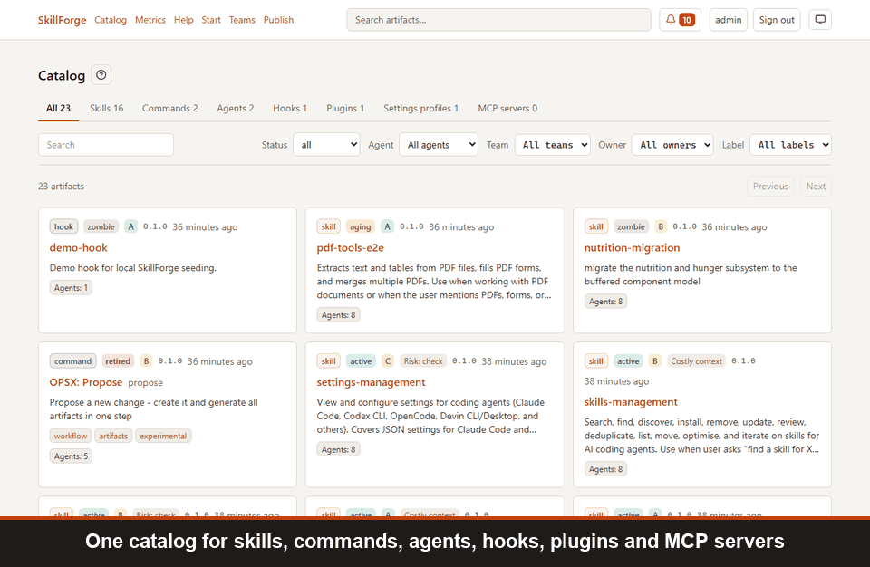
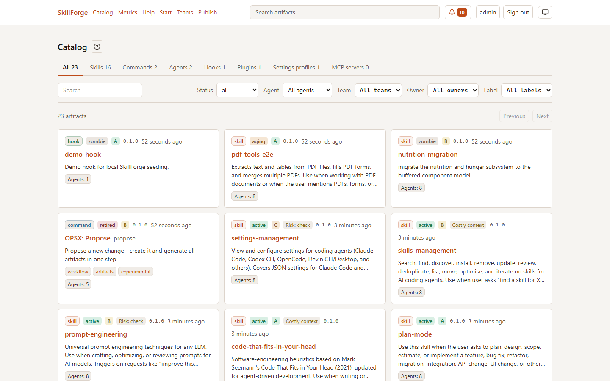
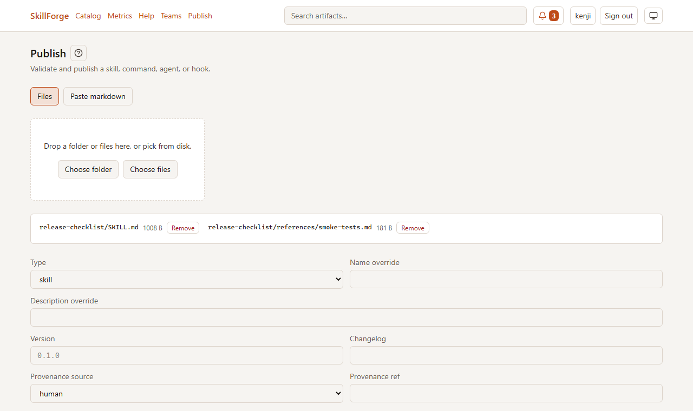
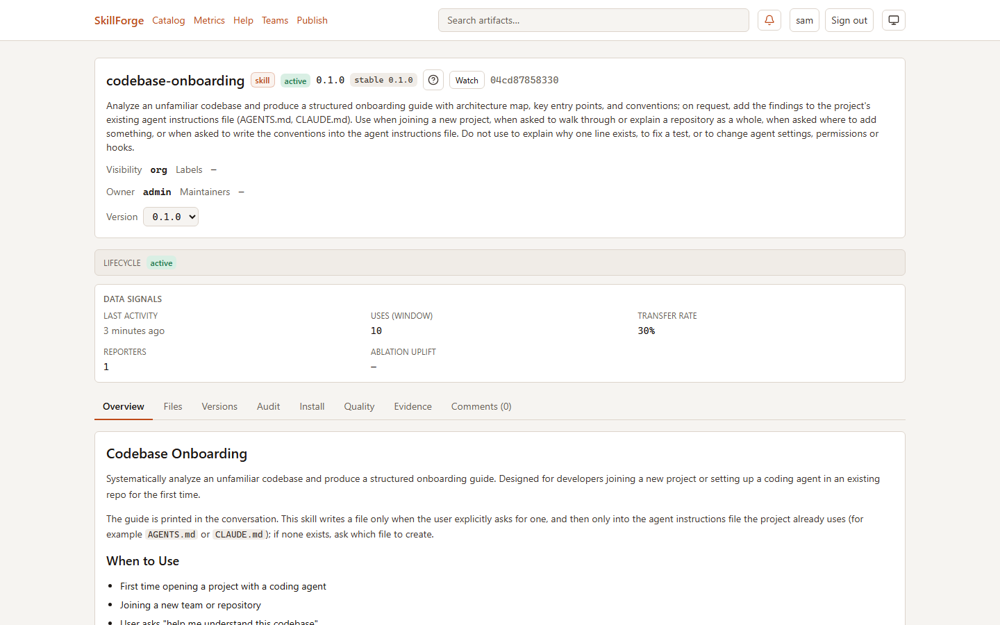
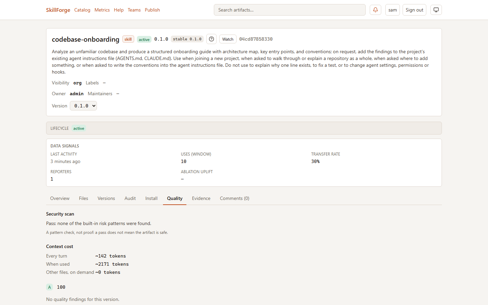
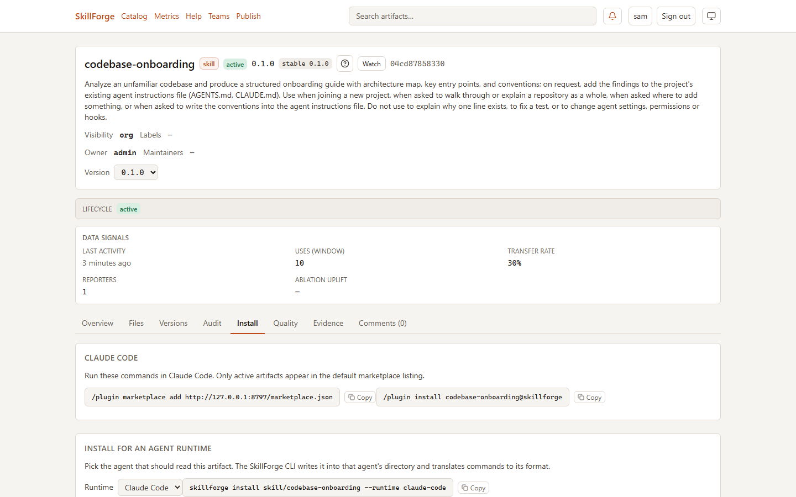
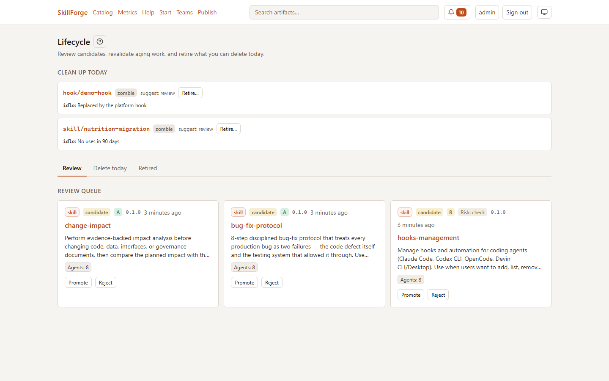
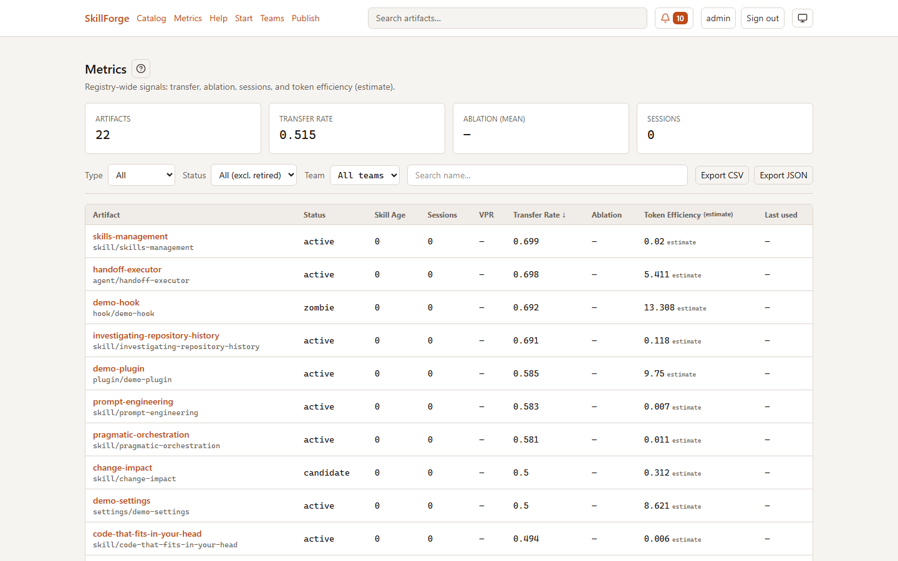
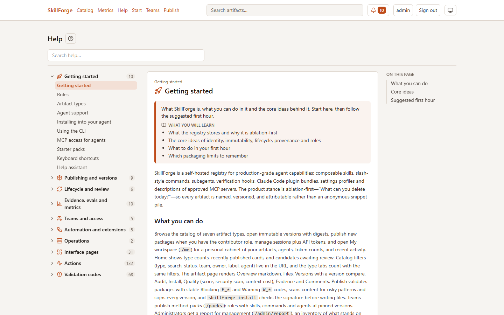

# SkillForge: a self-hosted registry for coding-agent artifacts

SkillForge is an internal marketplace for what your coding agents run on: **skills, commands, agents, hooks, plugins,
settings profiles and MCP servers**. Teams publish them once, reviewers decide what becomes trusted, and every
developer installs the same versions into Claude Code, Codex, Cursor, OpenCode, Gemini CLI, Qwen Code and other agents.
It runs on your own server; nothing leaves your infrastructure.



## On this page

- [Why SkillForge](#why-skillforge)
- [Features](#features)
- [Screenshots](#screenshots)
- [Quick start](#quick-start)
- [Supported agents](#supported-agents)
- [Documentation](#-documentation)
- [Development](#development)
- [License](#license)
- [See also](#see-also)

```
publish ──► candidate ──► review ──► active ──► aging ──► zombie ──► retired
               │                       ▲  (usage, quality and age move it along; people decide)  │
               └── checks: validation, quality score, security scan, evidence, evals ◄──────────┘
```

## Why SkillForge

- **One source of truth.** Prompts and agent settings stop living in personal folders and chat threads. Every
  artifact has an owner, a version history, a changelog and a status everyone can see.
- **People decide what is trusted.** A new artifact starts as a candidate. Reviewers promote it after the checks;
  an author cannot promote their own work. Versions are immutable and signed, so what was reviewed is what installs.
- **Checks before trust.** Validation per type, a quality score, a security scan with an install policy, hook risk
  analysis, duplicates and context cost, evidence and evals attached to versions.
- **Lifecycle by data.** Usage reports, quality and age move artifacts from active to aging and zombie, and the
  cleanup board shows what to retire today, so the registry does not rot.
- **Every agent, one process.** The CLI translates each artifact into the folders and formats of each agent and keeps a
  lock file, so a team can mix tools.
- **Your infrastructure.** One Node.js process with SQLite and a folder of blobs, or a Docker image. No telemetry, no
  cloud account; backups and diagnostics are built in.

More in [Why SkillForge](docs/en/01-why-skillforge.md).

## Features

- **Seven artifact types** — skills, commands, agents, hooks, plugins, settings profiles and MCP servers, each with
  its own validation ([Artifact types](docs/en/05-artifact-types.md)).
- **Publishing and import** — the web interface, the CLI, imports from zip archives, folders and git, upstream mirrors
  and starter packs ([Publishing and import](docs/en/06-publishing-and-import.md)).
- **Review and lifecycle** — candidate review, the lifecycle board, holds and replacements
  ([Lifecycle and review](docs/en/07-lifecycle-and-review.md)).
- **Versions and channels** — stable and beta channels, pins, downgrade protection, an acceptance gate, version diffs
  and rollback ([Versions and channels](docs/en/10-versions-and-channels.md)).
- **Teams and visibility** — organization and team scopes, ownership, co-authors and team availability
  ([Teams, visibility and ownership](docs/en/11-teams-visibility-ownership.md)).
- **Agents and inventory** — agent snapshots, the organization inventory and shadow MCP servers
  ([Agents and inventory](docs/en/12-agents-and-inventory.md)).
- **MCP** — the registry as an MCP server for agents, and MCP servers as governed artifacts with an origin policy
  ([MCP](docs/en/13-mcp.md)).
- **Metrics** — a metrics dashboard, session metrics from local agent logs, transfer rate
  ([Metrics dashboard](docs/en/15-metrics-dashboard.md)).
- **Server plugins** — extend the registry without forking it; the bundled `review-assistant` runs independent model
  reviews ([Plugins](docs/en/14-plugins.md)).
- **Sign-in** — passwords, OIDC (including Google) and LDAP/Active Directory, four roles
  ([Handbook](docs/en/handbook/README.md)).
- **In-app help** — every page has a help topic, and an optional assistant answers from the help with your own model.

## Screenshots

| | |
|---|---|
| **Catalog** — every type in one place, with status, quality grade, risk and the agents an artifact is for.<br> | **Publish** — drop a folder: the type is detected and the files are validated before anything is stored.<br> |
| **An artifact** — description, lifecycle status, usage signals and transfer rate, tabs for files, versions, audit and evidence.<br> | **Quality** — the security scan, context cost in tokens and the quality grade of every version.<br> |
| **Install** — one command per agent: the Claude Code marketplace or the CLI for any supported runtime.<br> | **Lifecycle** — what to clean up today and the review queue: promote or reject candidates.<br> |
| **Metrics** — transfer rate, sessions and token efficiency across the registry, with CSV and JSON export.<br> | **In-app help** — a topic for every page, action and validation code, and an optional assistant.<br> |

## Quick start

**Run the registry** with Docker, one command:

```bash
docker run -d --name skillforge -p 8787:8787 -v skillforge-data:/data ghcr.io/marin-ai-tech/skillforge:latest
docker exec skillforge cat /data/initial-admin-password.txt   # the generated password of admin
```

Open `http://localhost:8787` and sign in as `admin`. To build the image yourself, clone the repository and run
`docker compose up -d --build`. Release archives and a Windows installer are on the
[releases page](https://github.com/marin-ai-tech/skillforge/releases/latest); see
[Self-hosting](docs/en/03-self-hosting.md) for every option.

**Install the CLI** from the latest release (a registry installed from a release archive also serves it at
`/downloads/skillforge-cli.tgz`, and its home page shows the command):

```bash
npm i -g https://github.com/marin-ai-tech/skillforge/releases/latest/download/skillforge-cli.tgz
skillforge login --url http://localhost:8787 --username admin --password-stdin
```

**Publish and install:**

```bash
skillforge validate ./skills/my-skill
skillforge publish ./skills/my-skill
skillforge install skill/my-skill --runtime codex
skillforge sync --status active --runtime claude-code
```

## Supported agents

| Agent | `--runtime` | Skills | Commands | Agents | MCP |
|---|---|---|---|---|---|
| [Claude Code](docs/en/agents/claude-code.md) | `claude-code` | yes | yes | yes | yes |
| [Codex](docs/en/agents/codex.md) | `codex` | yes | — | TOML | yes |
| [Gemini CLI](docs/en/agents/gemini-cli.md) | `gemini` | yes | TOML | — | over HTTP |
| [Cursor](docs/en/agents/cursor.md) | `cursor` | yes | project scope | trimmed | yes |
| [OpenCode](docs/en/agents/opencode.md) | `opencode` | yes | trimmed | subagents | yes |
| [Qwen Code](docs/en/agents/qwen-code.md) | `qwen` | yes | yes | yes | yes |
| [Devin](docs/en/agents/devin.md) | `devin` | project skills | — | — | over HTTP |
| [Reckon](docs/en/agents/reckon.md) | `reckon` | project skills | — | — | through Claude Code |

Hooks, plugins and settings profiles go to the agents that support them. What each agent gets, where its files
go and how it connects: [Agents](docs/en/agents/README.md) and the in-app help topic `getting-started/agent-support`.

## 📚 Documentation

The [documentation index](docs/en/README.md) lists every topic.

**Start here:**

- [User guide](docs/en/02-user-guide.md) — publish, review and install artifacts.
- [Self-hosting](docs/en/03-self-hosting.md) — install, configure, upgrade and back up the registry.
- [Handbook](docs/en/handbook/README.md) — what each role does: viewer, contributor, reviewer, admin.
- [Glossary](docs/en/glossary.md) — look up a term as you read.

**Guides and reference:**

- [Architecture](docs/en/04-architecture.md) — how the parts fit together.
- [Quality and security](docs/en/09-quality-and-security.md) — the checks and policies.
- [Backups and operations](docs/en/20-backups-and-operations.md) — health, diagnostics, logs.
- [Cookbook](docs/en/21-cookbook.md) — recipes for common tasks.

## Development

Node.js 24 or later.

```bash
npm ci
npm run build
npm run lint
npm test
node --test --test-concurrency=2 tests/*.test.mjs
npx playwright test
```

`npm run dev:server` and `npm run dev:web` run the server and the web interface from source. See
[CONTRIBUTING.md](CONTRIBUTING.md) for the contribution rules, releases and adding an interface language.

## License

SkillForge is dual-licensed. The **Community License** (free) is the
[PolyForm Noncommercial License 1.0.0](LICENSES/PolyForm-Noncommercial-1.0.0.md) with the
[SkillForge Additional Permissions](LICENSES/SkillForge-Additional-Permissions.md): noncommercial use,
**open source projects** (complete source public under an OSI-approved license, also when a company maintains them)
and a 30-day evaluation.

> Every other use — a company's internal registry, private repositories, internal systems, proprietary products, client work, hosted services,
> redistribution — needs the **Commercial License**: see [COMMERCIAL-LICENSE.md](COMMERCIAL-LICENSE.md).

You own the artifacts you publish. Third-party starter packs keep their own licenses ([NOTICE.md](NOTICE.md)).
Contributions need the [CLA](CLA.md) (see [CONTRIBUTING.md](CONTRIBUTING.md)). Privacy: [PRIVACY.md](PRIVACY.md).

Required Notice: Copyright (c) 2026 marin-ai technologies (https://github.com/marin-ai-tech/skillforge)

## See also

- [Documentation index](docs/en/README.md) — choose a guide.
- [Glossary](docs/en/glossary.md) — look up registry terms.
- [Changelog](CHANGELOG.md) — what changed in each version.
